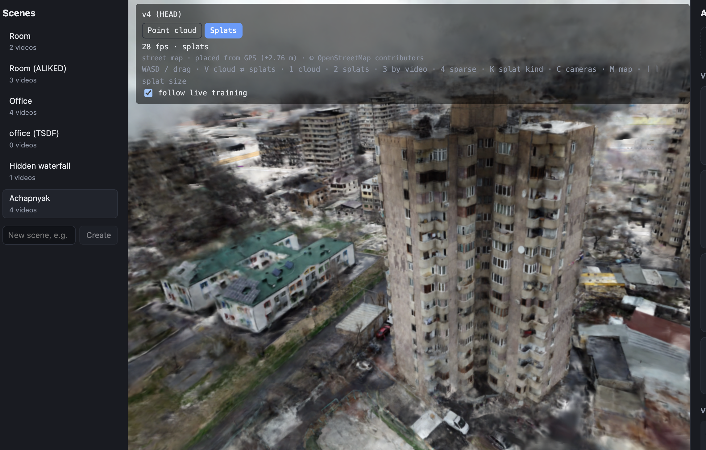

# city-splats

Upload videos of a place (drone, phone, action camera) and they are merged, one by one, into a
single 3D scene: a dense point cloud by default, Gaussian splats on request, streamed to the
browser with levels of detail. Each video becomes a new version of the scene, so a bad one can
be reverted.



## What it does

- **Per-video reconstruction.** Frames are extracted and filtered (blur, exposure), keyframes
  picked, then COLMAP (pycolmap) builds the video's own model with ALIKED + LightGlue features.
  Long videos are mapped in overlapping chunks of ~200 frames that are chained back together.
- **GPS priors.** DJI subtitle telemetry (lat/lon, height above takeoff, distance from home)
  becomes camera position priors, keeping scale consistent along a flight and placing videos
  relative to each other.
- **Fitting into the scene.** A new video's model is matched against the nearest frames of
  the existing scene (retrieval, limited to frames within 200 m when both sides have GPS) and
  placed by a robust similarity transform from 3D-3D correspondences. Existing parts never move.
- **Dense cloud, in tiles.** Depth Anything V2 depth maps, scaled to the SfM points, are fused
  and streamed to disk by region, then merged into an octree of tiles on a global voxel grid.
  A new video re-merges and rebuilds only the tiles it touches (in parallel, memory bounded by
  a tile), and the viewer streams each tile as its own LoD (Spark `.rad`), all under one splat
  budget.
- **Splats.** [Brush](https://github.com/ArthurBrussee/brush) trains on request (quick / full /
  uniform), with live previews while training; output is cleaned and built into a LoD as well.
  GPS scenes train in ground blocks of ~500 frames, each with the full steps, so quality per
  area doesn't drop as videos are added; each block is cropped to its area and streamed as
  its own LoD. Per-scene settings can train blocks on more than the SfM keyframes (extra
  frames between them, keyframes decoded again at full resolution, one camera per video) and
  start them from the dense cloud.
- **Viewer.** three.js + [Spark](https://github.com/sparkjsdev/spark): dense cloud, splats,
  sparse points by video, camera positions, and, for GPS scenes, an OpenStreetMap or
  satellite map laid under the scene on the fitted ground plane.
- **Versions.** Every accepted video publishes a version; HEAD can be moved back to any one.
  Progress (with ETAs learned from past runs) streams to the UI over SSE.

## Layout

```
backend/    FastAPI: scenes, uploads, versions, training requests, SSE, static files
worker/     job runner; worker/pipeline/ holds the stages (ingest, sfm, pieces, dense, splat, ...)
frontend/   Vite + React + TypeScript viewer and control panel
infra/      COLMAP build script and patches for COLMAP and Brush
scripts/    dev.sh (run everything) and maintenance scripts
spikes/     benchmarks and experiments
data/       scenes, database, logs (not in git)
tools/      third-party sources and builds (not in git)
```

## Setup (macOS, Apple Silicon)

Requirements: Python 3.12 with [uv](https://docs.astral.sh/uv/), Node 20+, Rust, ffmpeg,
Homebrew `cmake ninja libomp` and COLMAP's build dependencies.

```bash
uv venv --python 3.12 && uv sync

# COLMAP + pycolmap with ONNX (ALIKED/LightGlue); applies infra/patches/colmap-*.patch
infra/build_colmap.sh

# Brush (splat training), patched for fixed/frozen scales and a chosen eval split (needs Rust 1.95)
git clone https://github.com/ArthurBrussee/brush tools/brush-src
git -C tools/brush-src checkout 1388f74c6fe0236f68ee4915564bf00e9d2e3747
git -C tools/brush-src apply ../../infra/patches/brush-local.patch
(cd tools/brush-src && cargo +1.95 build --release -p brush-cli)

# Spark's build-lod (LoD files for the viewer)
git clone https://github.com/sparkjsdev/spark tools/spark
git -C tools/spark checkout ffe210dc0a45d0515a06c9235878108112827d61
(cd tools/spark/rust && cargo build --release -p build-lod)

(cd frontend && npm install)
```

Tool paths can be overridden with `BRUSH_BIN` and `BUILD_LOD_BIN`; other settings (training
steps, link radius, parallelism, dense stride) are environment variables documented in
`backend/app/config.py`. On Linux with CUDA (e.g. DGX Spark) the same build script enables
CUDA in COLMAP.

## Running

```bash
scripts/dev.sh
```

starts the backend (http://localhost:8000), the worker and the frontend
(http://localhost:5173); logs go to `data/logs/`. Create a scene, drop videos onto it, and
watch them process. Viewer keys: WASD/drag to move (Q/E down/up, Shift faster), `V` cloud ⇄
splats, `1`–`4` view modes, `C` cameras, `K` splat kind, `M` map (street → satellite → off),
`[` `]` splat size.

## Status

A working prototype, developed on an M3 MacBook (CPU SfM, Metal for depth and Brush).
Known gaps: rigid placement leaves ~5–15 px of misalignment between videos; scenes without
GPS still train splats in one run; QC gates are minimal.
